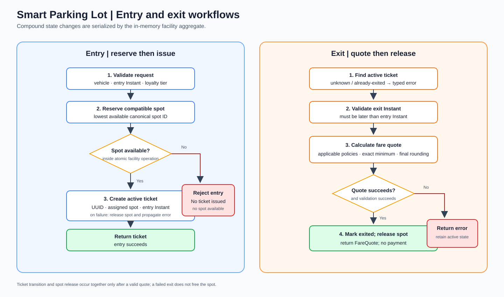

# Smart Parking Lot Rate Calculator

This repository contains the approved design and phased Java implementation for ticket issuance, compatible spot assignment, and lowest-valid-fare calculation. Payment processing is explicitly out of scope.

The implementation follows the approved design: keep the system simple, use Java 17 and JDK production libraries, separate domain behavior from application orchestration, and verify behavior with JUnit.

## Project status

Stages 1-4 (business specification, domain design, test strategy, and system architecture) are approved and published. Phase 1 (domain objects and unit tests) is complete; Phase 2 (interfaces and their contract tests) is underway. Business logic awaits confirmation between phases.

## Build and tests

Run the current unit test suite with:

```sh
./mvnw test
```

The current domain and interface-contract suite is run with `./mvnw test`.

## Confirmed decisions

- Vehicle categories are Motorcycle, Car, and Bus, with car-rate multipliers of 0.8, 1.0, and 2.0 respectively.
- The only spot compatibility pairs are Motorcycle→Compact, Car→Compact, and Bus→Large.
- Hourly base pricing applies every day. The peak surcharge is limited to weekdays, excluding US federal holidays.
- Early Bird and Night Owl are eligible only on weekdays excluding US federal holidays.
- Use the US Office of Personnel Management (OPM) federal holiday schedule, including observed weekdays.
- Early Bird and Night Owl remain eligible when loyalty is `None`; in that case, the discount is 0%.
- Store the customer's loyalty tier on the ticket; default it to `None`.
- Vehicle multipliers apply to special-rate fees as well as hourly fees.
- Invalid inputs should raise an appropriate exception.
- Calculate the selected fare and round the final amount to cents using half-up rounding.
- If fares tie, prefer Early Bird, then Night Owl, then Standard Hourly.
- If a stay exceeds 24 hours, only Standard Hourly is evaluated.
- Default the facility timezone to `America/Los_Angeles` for the current implementation. Payment is not part of this plan.
- Require a ticket to exit once only and release its spot after successful exit.
- Reject entry with an appropriate message when no compatible spot is available.
- Keep ticket and spot state in memory; surviving process restarts is not required.
- For Night Owl, require both entry and exit dates to be weekdays excluding federal holidays.
- Determine fare ties from exact amounts; values that only tie after cent rounding do not use tie precedence.

## Source documents

- `Assignment_Instructions.pdf` — assignment design, testing, technology, and AI-transparency requirements supplied by the user.
- `The_Smart_Parking_Lot_v2.pdf` — parking and pricing requirements supplied by the user.

The source PDFs were provided from `/home/shyamsrk/` and are not copied into this repository.

## Architecture clarification status

The Stage 4 design questions have been resolved and recorded. Implementation remains paused pending the next instruction.

## Architecture diagrams

These diagrams illustrate the system boundary, component responsibilities, and entry/exit workflows documented in [`docs/system-architecture.md`](docs/system-architecture.md).




## Design decisions and trade-offs

The Stage 2 design is approved; the Stage 4 system architecture records the user's resolved choices:

- Keep entry/exit orchestration, spot inventory, and each pricing policy separate; this is clearer to test than a single service with interleaved conditionals.
- Use three explicit policy implementations behind a small shared contract rather than a configurable rules engine; there are only three fixed policies in scope.
- Use decimal-safe money arithmetic and round once at the final-fare boundary rather than using binary floating point or rounding each hourly segment.
- Use the documented `America/Los_Angeles` facility-timezone default for the current implementation, with the timezone kept configurable.
- Use the US OPM federal holiday schedule, including observed weekdays, as the holiday-calendar source.
- Keep the domain plan independent of a database, web API, UI, payment framework, and selected language, as required by the assignment; use in-memory state for this assignment.
- Target Java 17, Maven Wrapper 3.9.9, JUnit Jupiter 5.11.4, and base package `com.sahaj.smartparkinglot`; production code should use JDK standard libraries only.
- Load versioned per-year OPM holiday data from repository resources; accept `Instant` timestamps only; serialize concurrent state transitions in memory.
- Assign spots by ascending canonical spot ID, generate ticket IDs with JDK UUIDs, and report typed domain/application exceptions for callers to format.

See [`docs/specification.md`](docs/specification.md) for the functional specification and acceptance criteria, [`docs/design.md`](docs/design.md) for the approved domain model, [`docs/system-architecture.md`](docs/system-architecture.md) for the proposed Java system design, [`docs/test-plan.md`](docs/test-plan.md) for the approved test strategy, and [`ai-chat-history.md`](ai-chat-history.md) for the user prompts and decisions recorded for this project.
