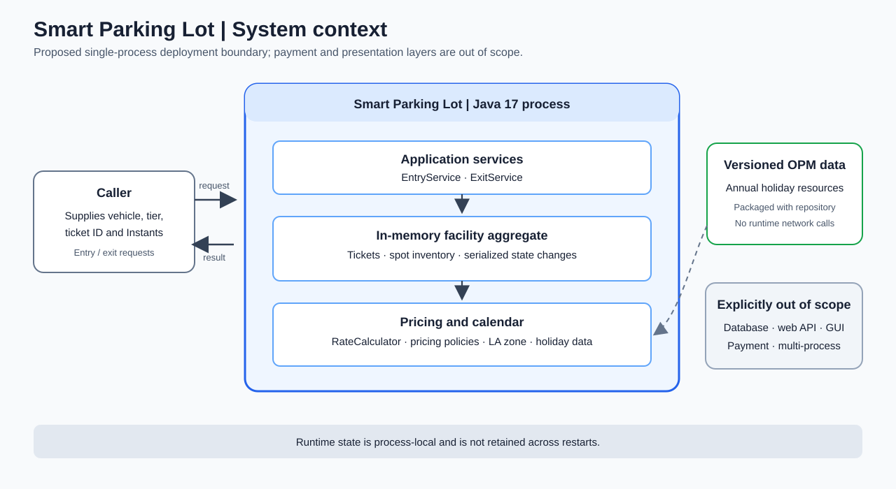
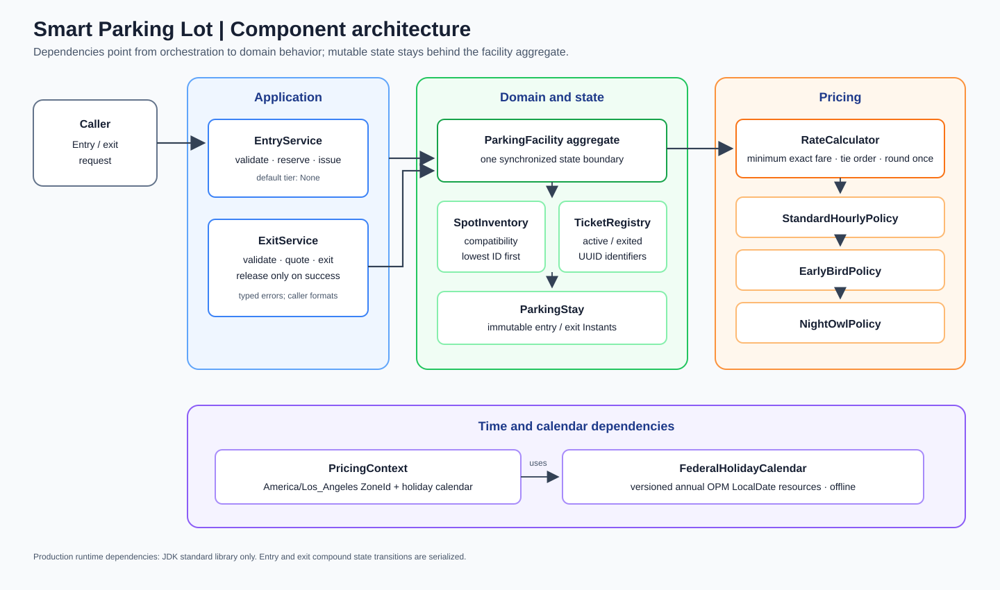
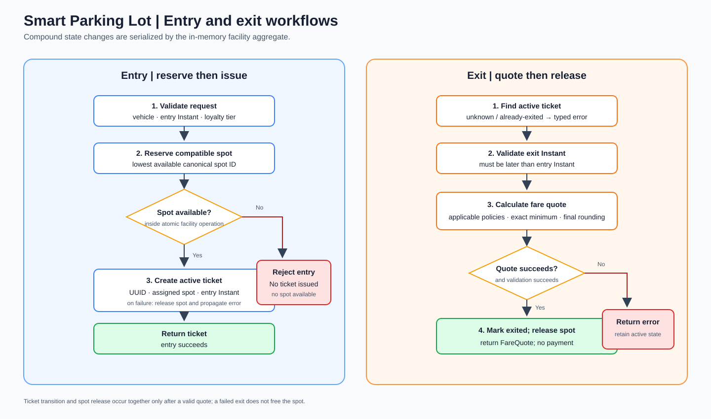

# Stage 4: System Architecture

## Status and scope

System design updated with the user's decisions on the previously open questions. It refines the approved business specification and domain model for the selected Java technology stack. Implementation is proceeding in user-directed phases.

The design covers ticket entry, in-memory spot assignment, fee calculation at exit, and the test/build structure. Payment, a web API, GUI, database, and multi-process deployment remain out of scope.

## Technology baseline

| Concern | Selected / available |
|---|---|
| Language/runtime | Java 17; OpenJDK 17.0.21.1 is installed |
| Build | Maven; Maven 3.9.9 is installed |
| Tests | JUnit Jupiter 5.11.4; artifacts are present in the local Maven cache |
| Production dependencies | JDK standard library only |
| Build reproducibility | Include Maven Wrapper pinned to 3.9.9 |
| Project build configuration | Maven project scaffold added in Phase 1 |

Java 17, Maven 3.9.9, Maven Wrapper 3.9.9, and JUnit Jupiter 5.11.4 are the selected implementation stack. No dependency was downloaded and no build or test was run during this design stage.

## System context and shape

The smallest proposed deployment is a single Java process with a modular domain core and in-memory state. This avoids introducing a database, REST framework, or dependency-injection framework for a fixed, small domain.

### Architecture diagrams

The following diagrams visualize the proposed system boundary, internal components, and state-changing workflows:







The caller/entry point is intentionally not defined. It may be a small demonstration harness later, but no CLI, GUI, or network API is assumed by this design.

## Component responsibilities and dependencies

### Application layer

- **`EntryService`** accepts vehicle type, entry instant, and loyalty tier (default `None`). It validates the request, obtains a compatible spot, creates a ticket, and returns it.
- **`ExitService`** accepts a ticket ID and exit instant. It rejects missing or already-exited tickets, validates the stay, requests a fare quote, and on successful calculation marks the ticket exited and releases its spot.
- Application services coordinate domain operations. They do not contain rate arithmetic or expose mutable inventory collections.

### Domain layer

- **`ParkingFacility` / in-memory state owner** contains the configured spots and tickets, including exited-ticket state for duplicate-exit detection. It owns state transitions that must remain consistent.
- **`SpotInventory`** checks the fixed vehicle/spot matrix, reserves an available compatible spot, and releases a spot only for the matching exited ticket.
- **`ParkingTicket`** holds ID, entry instant, vehicle type, assigned spot ID, loyalty tier, and `ACTIVE`/`EXITED` state. A successful exit is allowed once.
- **`ParkingStay`** is an immutable calculation input derived from an active ticket and a later exit instant.
- **`RateCalculator`** evaluates every policy applicable to the stay, selects the least exact amount, applies the confirmed exact-tie precedence, and rounds the winning amount once into a `FareQuote`.
- **`StandardHourlyPolicy`, `EarlyBirdPolicy`, and `NightOwlPolicy`** contain their own eligibility and price calculation rules and return an exact `FareCandidate` when applicable.
- **`Money`, `FareCandidate`, and `FareQuote`** carry exact USD amounts and selected-policy details; money arithmetic must not use binary floating point.

### Calendar and time boundary

- Represent entry/exit instants as `java.time.Instant`; calculate elapsed duration from instants.
- Use `java.time.ZoneId` with the facility default `America/Los_Angeles` to derive local dates and times for rate windows.
- Supply holiday membership through a `FederalHolidayCalendar` dependency backed by versioned, per-year data resources in the repository. Update the resources from the US OPM schedule, including observed weekdays; do not make runtime network calls. Missing or invalid holiday data must fail explicitly.
- Store one ISO-8601 `LocalDate` per line in each annual resource, representing dates treated as holidays (including observed dates). Include the OPM source and schedule year in resource metadata; parse with JDK `java.time`.
- Use half-open time intervals for overlap checks. For an hourly segment, evaluate its entire elapsed one-hour interval against all relevant facility-local dates and peak windows.
- Accept `Instant` values only for entry and exit. Elapsed duration follows the instant timeline; local wall-time input is outside the application contract. Use Java's `ZoneId` rules to derive local dates/windows.
- The Instant-only contract removes ambiguous/nonexistent local input. Spring/fall transitions still affect local rendering; elapsed hourly segments remain based on actual instants.

## Entry workflow

1. Validate the vehicle type and request data.
2. Ask the inventory to atomically reserve a compatible available spot.
3. If none exists, return an explicit no-compatible-spot error and issue no ticket.
4. Create an active ticket with a unique ID, entry instant, vehicle, spot, and tier (`None` when omitted).
5. If ticket creation fails after reservation, release the reservation before propagating the error.

When multiple compatible spaces are free, select the lowest spot ID first. IDs are compared in ascending natural `String` order and should use a canonical format so this order is stable.

## Exit workflow

1. Find the ticket and require its state to be `ACTIVE`.
2. Validate that the exit instant is after entry; create an immutable `ParkingStay`.
3. Use a `PricingContext` containing the facility zone and OPM calendar to evaluate the policies.
4. Choose the exact minimum candidate; use Early Bird, Night Owl, Standard Hourly for exact ties; round the winner half-up to cents.
5. Only after a valid quote exists, mark the ticket exited and release its assigned spot.
6. Return the quote. Do not initiate payment.

The facility exposes exit as one synchronized operation covering active-ticket validation, quote calculation, ticket transition, and spot release. This prevents concurrent duplicate exits from both succeeding and keeps ticket/inventory state consistent.

## Proposed Java project layout

Use `com.sahaj.smartparkinglot` as the project base package.

```text
pom.xml
src/
  main/java/com/sahaj/smartparkinglot/
    application/       EntryService, ExitService
    application/port/  SpotInventory, TicketRegistry, TicketIdGenerator
    domain/            ParkingFacility, ParkingTicket, ParkingSpot, ParkingStay
    domain/pricing/    Money, FareQuote, FareCalculator, RateCalculator, RatePolicy, policy classes
    domain/time/       PricingContext, FederalHolidayCalendar
    infrastructure/   in-memory inventory/state and OPM calendar data adapter
  test/java/com/sahaj/smartparkinglot/
    application/       entry/exit flow tests
    domain/            ticket, spot, stay tests
    domain/pricing/    hourly, special-policy, selection, and money tests
```

Use Maven's Java 17 compiler release setting, Maven Wrapper 3.9.9, and JUnit Jupiter 5.11.4. Production code should have no third-party runtime dependency. Maven's test lifecycle should run the JUnit suite.

Generate ticket IDs with `java.util.UUID.randomUUID()`. Tests should inject deterministic ticket IDs where assertions need stable values.

## State consistency and concurrency

In-memory state is accepted for this assignment, so a process restart loses tickets and occupancy. Entry allocation and exit/release still need atomic state transitions to prevent assigning one spot twice or leaving an exited ticket's spot occupied. Keep exited tickets in the registry for the process lifetime so repeated exits can be distinguished from unknown tickets.

Entry and exit calls may be concurrent. Guard compound in-memory state transitions with one lock using JDK synchronization, so two requests cannot reserve the same spot or exit the same ticket twice. Keep all state mutation behind the facility aggregate.

## Error behavior

Use explicit domain/application failures and do not silently substitute defaults other than the confirmed loyalty and timezone defaults. Candidate exception categories:

- `InvalidEntryRequestException` / `InvalidStayException` for invalid input and timestamps;
- `TicketNotFoundException` / `TicketAlreadyExitedException` for ticket lifecycle errors;
- `NoCompatibleSpotAvailableException` for allocation failure;
- `InvalidVehicleException` / `InvalidSpotException` for unsupported classifications;
- `InvalidPricingConfigurationException` for missing or invalid calendar/time configuration.

These typed domain/application exceptions are handled by the caller; message formatting belongs to the entry point. The no-space outcome is fixed: reject entry and issue no ticket.

## Design choices and alternatives

- **Single-process modular application** over distributed services: fewer moving parts, aligns with in-memory state and no API/database requirement; does not provide restart durability or horizontal scale.
- **Explicit policy classes** over a generic rules engine: keeps the three fixed rates easy to inspect and test; adding a future policy means adding one class and registering it.
- **JDK `java.time` and `BigDecimal`** over third-party date/money libraries: standard-library constraint, timezone-aware instants, and decimal-safe fee arithmetic.
- **Manual dependency wiring** over a DI framework: only a few services and policies need construction.
- **OPM calendar dependency** over live holiday lookups: deterministic offline calculations; schedule distribution/refresh needs a follow-up decision.

## Resolved architecture decisions

- **Holiday data:** Keep versioned per-year resources in the repository and update them from OPM; no runtime network calls.
- **Timestamps/DST:** Accept `Instant` only; calculate elapsed time on the instant timeline and convert to facility-local time with `America/Los_Angeles`.
- **Concurrency:** Permit concurrent calls and serialize compound state changes inside the in-memory facility aggregate.
- **Spot ordering:** Assign the lowest spot ID, using ascending natural `String` order over canonical IDs.
- **Package/build:** Use `com.sahaj.smartparkinglot`, Java 17, Maven Wrapper 3.9.9, and JUnit Jupiter 5.11.4.
- **Ticket IDs:** Use JDK UUIDs.
- **Errors:** Use typed domain/application exceptions; caller code is responsible for message formatting.

Each implementation phase is reviewed and confirmed before proceeding to the next.
